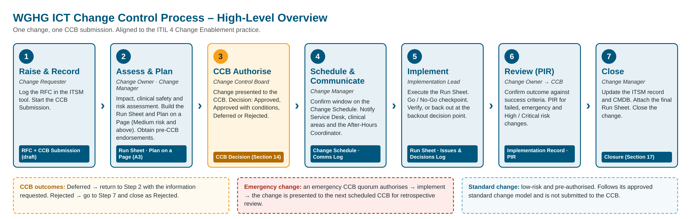
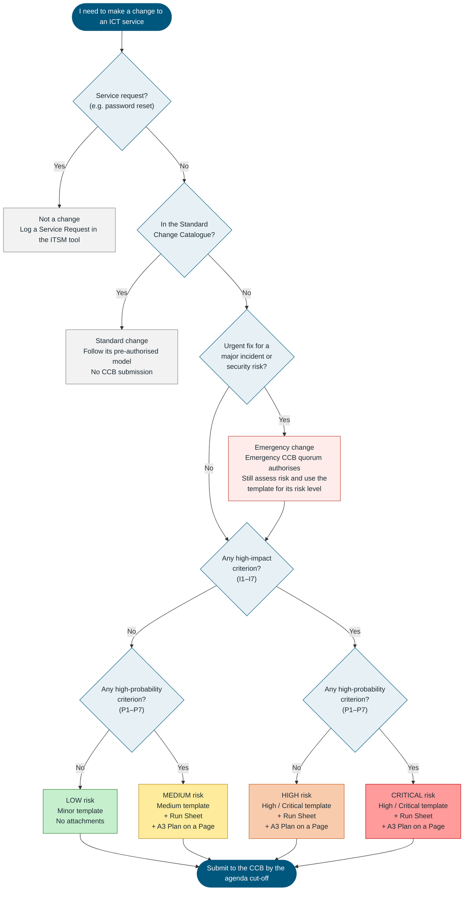
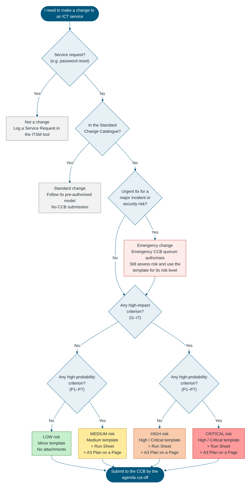

# Change Control Board (CCB) – ICT Change Submission: High / Critical Risk

**West Gippsland Healthcare Group (WGHG) – Information & Communication Technology**

**Full single change submission for High and Critical risk changes – aligned to ITIL 4 Change Enablement**

> **How to use this template:** Use this template for **one** High or Critical risk ICT change: any change with high impact. It is Critical if probability is also high. Low and Medium risk changes use the shorter **Minor** and **Medium** templates. Submit it to the CCB Secretariat by the agenda cut-off for the CCB meeting. Replace every `[Enter …]` placeholder and mark selections by replacing ☐ with ☒. Delete guidance notes (lines starting with *Guidance:*) before submission. The detailed, timed steps for this change belong in the companion **ICT Change Run Sheet** (Excel). Attach it to this submission. Section 14 is completed by the CCB at the meeting.

---

## Change Control Process – Where this Submission Fits

*Confluence: upload `assets/wghg-change-control-process.png` to this page and insert it here. The full process is in the **ICT Change Control Process** document.*

| Step | Stage | Who | This Submission | Companion File |
|---|---|---|---|---|
| 1 | Raise & Record | Change Requester | Sections 1, 3 | ITSM change record |
| 2 | Assess & Plan | Change Owner, Change Manager | Plan on a Page; Sections 2, 4–13 | Run Sheet (Excel), including the Plan on a Page tab |
| 3 | CCB Authorise | Change Control Board | Section 14 – CCB Decision | CCB agenda and minutes |
| 4 | Schedule & Communicate | Change Manager | Sections 11–12 | Run Sheet – Comms Log tab |
| 5 | Implement | Implementation Lead | Section 15 – Implementation Record | Run Sheet; Issues & Decisions Log |
| 6 | Review (PIR) | Change Owner, reported to the CCB | Section 16 – PIR | — |
| 7 | Close | Change Manager | Section 17 – Closure | ITSM change record |

**CCB outcomes:** Deferred → return to Step 2. Rejected → close as Rejected. **Emergency changes** are authorised by an emergency CCB quorum and presented at the next CCB for retrospective review.

---

## Which Change Process Should I Follow?

*Use this flowchart and the impact and probability criteria to decide whether the work is a change, which type of change it is, its risk level, and which CCB submission template to use.*

| Impact | Probability | Risk Level | Template to Use | Attachments |
|---|---|---|---|---|
| Low | Low | Low | **Minor** | None – implementation and backout steps are written in the form |
| Low | High | Medium | **Medium** | Run Sheet (Excel) and A3 Plan on a Page |
| High | Low | High | **High / Critical** | Run Sheet (Excel) and A3 Plan on a Page; PIR always required |
| High | High | Critical | **High / Critical** | Run Sheet (Excel) and A3 Plan on a Page; PIR always required; [Enter any extra endorsement WGHG requires, e.g. Executive sponsor] |

*Risk levels follow the ITIL approach of assessing a change's impact and the probability of the risk occurring. The High / Low criteria below and the mapping to Low / Medium / High / Critical are a WGHG starting point, to be refined.*

*Confluence: Confluence does not draw Mermaid diagrams without an add-on. Upload `assets/wghg-change-process-selector.png` and insert it here, or paste the Mermaid code above into a Mermaid macro if your site has one.*

---

## Plan on a Page (A3)

*Guidance: This one-page summary of the change is presented to the CCB. In Word it prints as a single A3 landscape page. The run sheet workbook has the same layout on its **Plan on a Page** tab, where the timeline fills in automatically from the run sheet.*

### Change at a Glance

| Field | Value | Field | Value |
|---|---|---|---|
| Change ID | [CHG0001234] | CCB Meeting Date | [DD/MM/YYYY] |
| Change Title | [Enter] | Decision Requested | [Approve for implementation] |
| Change Type | [Normal / Emergency] | Overall Risk Rating | [High / Critical] |
| Approved Window | [DD/MM/YYYY HH:MM – HH:MM] | Expected Outage | [Enter duration and services] |

### What, Why and Success

| What is changing | Why it is needed | Success criteria and benefits |
|---|---|---|
| [Enter, in plain language] | [Enter driver and the consequence of not proceeding] | [Enter measurable success criteria] |

### Timeline

| Phase | Key Activities | Owner | Planned Start | Planned End |
|---|---|---|---|---|
| 1. Pre-Implementation | [Backups, notifications, pre-checks] | [Name] | [HH:MM] | [HH:MM] |
| 2. Go / No-Go | Go / No-Go decision | [Change Manager] | [HH:MM] | [HH:MM] |
| 3. Implementation | [Enter key activities] | [Name] | [HH:MM] | [HH:MM] |
| 4. Verification | [Technical and clinical verification] | [Name] | [HH:MM] | [HH:MM] |
| ◆ Backout decision point | Latest time to start a backout | [Change Manager] | [HH:MM] | — |
| 5. Post-Implementation | [Notify completion, monitor, update records] | [Name] | [HH:MM] | [HH:MM] |
| 6. Backout (only if invoked) | [Enter backout summary] | [Name] | [HH:MM] | [HH:MM] |

### Impact, Risk and Backout

| Impacted services, sites and users | Top risks and mitigations | Backout plan |
|---|---|---|
| [Services / CIs; sites and departments; number of users; clinical impact and downtime procedures] | [R1 – rating – mitigation; R2 – rating – mitigation; R3 – rating – mitigation] | [Trigger; decision point; decision maker; duration; tested ☐ Yes ☐ No] |

### Communications, Readiness and Contacts

| Communications | Readiness checklist | Key contacts |
|---|---|---|
| [Service Desk – when; clinical areas / NUMs – when; After-Hours Coordinator – when; vendors – when; all users – start and completion] | ☐ Pre-CCB endorsements ☐ Testing complete ☐ Backup / snapshot plan confirmed ☐ Run Sheet finalised ☐ Downtime procedures confirmed ☐ Vendor support confirmed ☐ Service Desk briefed | [Change Manager – name, mobile; Implementation Lead – name, mobile; Business / Clinical Owner – name, mobile; After-Hours Coordinator – phone; Vendor – phone] |

---

## 1. CCB Submission Details

| Field | Value |
|---|---|
| Change ID / RFC Number | [Enter ITSM ticket number, e.g. CHG0001234] |
| Change Title | [Enter short descriptive title] |
| CCB Meeting Date | [DD/MM/YYYY] |
| CCB Agenda Item No. | [Enter] |
| Submitted By | [Name, position] |
| Presenting to CCB | [Name, position] |
| Date Submitted to CCB Secretariat | [DD/MM/YYYY] |
| Decision Requested from CCB | ☐ Approve for implementation ☐ Approve in principle (return with final plan) ☐ Note – retrospective review of an emergency change |
| Submission Version | [0.1] |
| Related Records | [Enter related incident / problem / project / release IDs] |

### Submission Version History

| Version | Date | Author | Summary of Changes |
|---|---|---|---|
| 0.1 | [DD/MM/YYYY] | [Name] | Initial draft |
| | | | |

---

## 2. Executive Summary for the CCB

*Guidance: Keep this section to half a page. CCB members should be able to understand the change and the decision required from this section alone.*

| Item | Summary |
|---|---|
| What is changing | [One or two sentences in plain language] |
| Why it is needed | [Driver, e.g. vendor end-of-support, security vulnerability, incident / problem resolution, clinical service improvement] |
| When | [DD/MM/YYYY HH:MM – HH:MM] |
| Who / what is affected | [Services, sites, departments and approximate number of users] |
| Service outage | ☐ No outage ☐ Degraded service ☐ Full outage. Duration: [Enter] |
| Clinical / patient safety impact | ☐ None ☐ Low ☐ Medium ☐ High. [Enter one-line summary] |
| Overall risk rating (Section 7) | ☐ High ☐ Critical |
| Backout available | ☐ Yes ☐ No. Estimated backout time: [Enter] |
| Recommendation to the CCB | [Enter, e.g. "The CCB approves CHG0001234 for implementation on DD/MM/YYYY."] |

---

## 3. Change Details

| Field | Value |
|---|---|
| Change Requester (raised by) | [Name, position, department] |
| Change Owner (accountable) | [Name, position] |
| Change Implementer / Technical Lead | [Name, team] |
| Business / Clinical Owner | [Name, position, e.g. Nurse Unit Manager, Director of Clinical Services] |
| Service(s) Affected | [Enter business / clinical service(s)] |
| Configuration Item(s) (CIs) Affected | [Enter CMDB CIs: servers, applications, network devices, interfaces] |
| Site(s) / Location(s) Affected | [Enter WGHG site(s), building(s), ward(s) / department(s)] |
| Change Type | ☐ Normal ☐ Emergency |
| Change Category | ☐ Infrastructure ☐ Application ☐ Network ☐ Security ☐ Clinical System ☐ Medical Device Integration ☐ End-User Computing ☐ Telephony ☐ Other: [Enter] |
| Priority | ☐ Low ☐ Medium ☐ High ☐ Critical |
| Proposed Implementation Window | Start: [DD/MM/YYYY HH:MM] – End: [DD/MM/YYYY HH:MM] |

*Guidance – ITIL 4 change types:* A **Normal** change must be scheduled, assessed and authorised by the change authority (the CCB) before implementation. An **Emergency** change must be implemented as soon as possible, e.g. to resolve a major incident or apply an urgent security patch. It is authorised by an emergency CCB quorum and then presented at the next CCB for retrospective review. **Standard** changes are low-risk and pre-authorised, so they are not submitted to the CCB.

---

## 4. Description of the Change

### 4.1 What is being changed?

[Enter a clear, non-technical description of the change, followed by technical detail.]

### 4.2 Reason for the change (business / clinical justification)

[Enter the driver and supporting evidence.]

### 4.3 Benefits / expected outcome

[Enter measurable benefits and success criteria.]

### 4.4 Consequences of NOT implementing the change

[Enter the risk to patient care, operations, security or compliance if the change does not proceed.]

### 4.5 Out of scope

[Enter anything explicitly excluded.]

---

## 5. ITIL "7 Rs" of Change Checklist

| # | Question | Response |
|---|---|---|
| 1 | Who **RAISED** the change? | [Enter] |
| 2 | What is the **REASON** for the change? | [Enter] |
| 3 | What is the **RETURN** required from the change? | [Enter] |
| 4 | What are the **RISKS** involved in the change? | [Summarise; detail in Section 7] |
| 5 | What **RESOURCES** are required to deliver the change? | [Enter people, tools, vendor support, budget] |
| 6 | Who is **RESPONSIBLE** for the build, test and implementation of the change? | [Enter] |
| 7 | What is the **RELATIONSHIP** between this change and other changes? | [Enter dependent / conflicting changes on the Change Schedule] |

---

## 6. Impact Assessment

### 6.1 Clinical and Patient Safety Impact

| Question | Yes / No | Details / Mitigation |
|---|---|---|
| Does the change affect a clinical system (e.g. EMR, PAS, pathology, radiology/PACS, pharmacy, theatre, emergency department systems)? | ☐ Yes ☐ No | [Enter] |
| Could the change affect patient care delivery, clinical decision-making or the availability of patient information? | ☐ Yes ☐ No | [Enter] |
| Does the change affect a medical device or a medical device interface? | ☐ Yes ☐ No | [Enter] |
| Are clinical downtime procedures required during the change? | ☐ Yes ☐ No | [Reference the downtime procedure] |
| Has a clinical representative reviewed and endorsed the change? | ☐ Yes ☐ No | [Name / position / date] |
| Does the change affect 24/7 critical areas (e.g. Emergency, ICU/HDU, Maternity, Theatres)? | ☐ Yes ☐ No | [Enter] |

### 6.2 Business and Service Impact

| Area | Impact (None / Low / Medium / High) | Details |
|---|---|---|
| Users / departments affected | [Select] | [Enter number of users and departments] |
| Service availability (outage / degradation) | [Select] | [Enter] |
| Integrations / interfaces (HL7, APIs, data feeds) | [Select] | [Enter] |
| Third-party / vendor services | [Select] | [Enter] |
| Reporting / data quality | [Select] | [Enter] |
| Finance / payroll / rostering | [Select] | [Enter] |
| Telephony / nurse call / paging | [Select] | [Enter] |

### 6.3 Information Security and Privacy Impact

| Question | Yes / No | Details |
|---|---|---|
| Does the change alter access controls, authentication or privileged access? | ☐ Yes ☐ No | [Enter] |
| Does the change involve health information or personal information? | ☐ Yes ☐ No | [Enter] |
| Does the change alter firewall rules, network segmentation or remote access? | ☐ Yes ☐ No | [Enter] |
| Has the Information Security team reviewed the change? | ☐ Yes ☐ No | [Name / date] |
| Is a privacy or security impact assessment required under WGHG policy? | ☐ Yes ☐ No | [Reference] |

---

## 7. Risk Assessment (ITIL Impact and Probability)

*Guidance: A High / Critical change meets at least one High-Impact criterion. It is **Critical** if any High-Probability criterion also applies, and **High** if none do. Then record the specific risks of this change in the risk register.*

### Impact and Probability Assessment

**Impact is High if ANY of these apply:**

| # | High-Impact Criterion | Applies? | Details |
|---|---|---|---|
| I1 | Affects a clinical system, patient care, or the availability of patient information | ☐ Yes ☐ No | [Enter] |
| I2 | Affects a medical device or a medical device interface | ☐ Yes ☐ No | [Enter] |
| I3 | Affects a 24/7 critical area (e.g. Emergency, ICU / HDU, Maternity, Theatres) | ☐ Yes ☐ No | [Enter] |
| I4 | Causes a user-facing outage or degraded service during clinical or business hours | ☐ Yes ☐ No | [Enter] |
| I5 | Affects more than [Enter threshold, e.g. 50] users, or more than one site | ☐ Yes ☐ No | [Enter] |
| I6 | Changes security controls, access, firewall rules, or how health or personal information is handled | ☐ Yes ☐ No | [Enter] |
| I7 | Affects integrations or interfaces with other systems | ☐ Yes ☐ No | [Enter] |

**Probability is High if ANY of these apply:**

| # | High-Probability Criterion | Applies? | Details |
|---|---|---|---|
| P1 | The change has not been done before at WGHG | ☐ Yes ☐ No | [Enter] |
| P2 | The change has not been tested in a test / UAT environment | ☐ Yes ☐ No | [Enter] |
| P3 | The change is complex: many steps, several teams or several CIs | ☐ Yes ☐ No | [Enter] |
| P4 | Success depends on a vendor or third party | ☐ Yes ☐ No | [Enter] |
| P5 | A similar change has failed or caused an incident before | ☐ Yes ☐ No | [Enter] |
| P6 | The backout has not been tested, or the change cannot be backed out | ☐ Yes ☐ No | [Enter] |
| P7 | The implementation window is tight for the work plus a full backout | ☐ Yes ☐ No | [Enter] |

| Impact ↓ / Probability → | Low Probability | High Probability |
|---|---|---|
| **High Impact** | High | Critical |
| **Low Impact** | Low | Medium |

### 7.1 Risk Register for this Change

| # | Risk Description | Impact (High / Low) | Probability (High / Low) | Risk Level | Mitigation / Control | Residual Risk Level | Owner |
|---|---|---|---|---|---|---|---|
| R1 | [Enter risk] | [ ] | [ ] | [ ] | [Enter] | [ ] | [Name] |
| R2 | [Enter risk] | [ ] | [ ] | [ ] | [Enter] | [ ] | [Name] |
| R3 | [Enter risk] | [ ] | [ ] | [ ] | [Enter] | [ ] | [Name] |

**Overall risk level:** ☐ High (high impact, low probability) ☐ Critical (high impact, high probability)

---

## 8. Implementation Plan (Summary)

*Guidance: Summarise the phases here. Record the detailed, timed steps in the **ICT Change Run Sheet** (Excel).*

| Phase | Activities | Responsible | Planned Start | Planned End |
|---|---|---|---|---|
| Pre-implementation | [Backups / snapshots, notifications, pre-checks] | [Name] | [DD/MM HH:MM] | [DD/MM HH:MM] |
| Go / No-Go decision | [Confirm readiness criteria are met] | [Change Manager] | [DD/MM HH:MM] | [DD/MM HH:MM] |
| Implementation | [Enter key implementation activities] | [Name] | [DD/MM HH:MM] | [DD/MM HH:MM] |
| Verification / testing | [Technical and user / clinical verification] | [Name] | [DD/MM HH:MM] | [DD/MM HH:MM] |
| Post-implementation | [Notifications, monitoring, record updates] | [Name] | [DD/MM HH:MM] | [DD/MM HH:MM] |

**Run Sheet reference:** [Attach or link the ICT Change Run Sheet file]

---

## 9. Test Plan

| Field | Details |
|---|---|
| Pre-implementation testing completed (Test / UAT environment) | ☐ Yes ☐ No ☐ N/A. [Enter results / evidence link] |
| Post-implementation technical verification | [Enter tests, e.g. service up, logs clean, interfaces flowing] |
| Business / clinical user verification | [Enter who verifies and how, e.g. test patient workflow] |
| Success criteria | [Enter measurable criteria that confirm success] |
| Evidence location | [Enter link to test evidence] |

---

## 10. Backout / Remediation Plan

| Field | Details |
|---|---|
| Backout trigger(s) | [Enter conditions that will trigger a backout, e.g. failed verification, exceeding the backout decision time] |
| Backout decision point (latest time) | [DD/MM/YYYY HH:MM] |
| Backout decision maker | [Name / role] |
| Backout steps (summary) | [Enter summary; detail in Run Sheet "Backout" phase] |
| Estimated backout duration | [Enter minutes / hours] |
| Backout tested? | ☐ Yes ☐ No. [Enter details] |
| Data restoration required? | ☐ Yes ☐ No. [Enter backup reference / snapshot ID] |
| Remediation if backout is not possible | [Enter fix-forward approach / vendor escalation] |

---

## 11. Schedule and Conflicts

| Field | Details |
|---|---|
| Proposed date and time | [DD/MM/YYYY HH:MM – HH:MM] |
| Rationale for the window | [Enter, e.g. lowest clinical activity, vendor availability] |
| Alternative / fallback window | [DD/MM/YYYY HH:MM – HH:MM] |
| Conflicts with change freeze / blackout periods? | ☐ Yes ☐ No. [Enter details] |
| Conflicts with other scheduled changes (Change Schedule checked)? | ☐ Yes ☐ No. [Enter change IDs] |
| Conflicts with clinical activities (e.g. theatre lists, clinics, peak ED times)? | ☐ Yes ☐ No. [Enter details] |

---

## 12. Communication Plan

| Audience | Message | Channel (email / intranet / phone / huddle) | Sender | When |
|---|---|---|---|---|
| ICT Service Desk | Change details, expected calls, workarounds | [Enter] | [Name] | [Enter, e.g. 5 business days prior] |
| Affected clinical areas / NUMs | Outage window, downtime procedures | [Enter] | [Name] | [Enter] |
| After-Hours Hospital Coordinator / Manager | Outage window, escalation contacts | [Enter] | [Name] | [Enter] |
| Executive / Senior Management | Summary of the change and its risk | [Enter] | [Name] | [Enter] |
| Vendors / third parties | Confirmation of support during the window | [Enter] | [Name] | [Enter] |
| All affected users | Start, completion and any issues | [Enter] | [Name] | Start and completion |

---

## 13. Roles and Pre-CCB Endorsements

### 13.1 Roles and Responsibilities (RACI)

R = Responsible · A = Accountable · C = Consulted · I = Informed

| Activity | Change Requester | Change Owner | Change Manager | Technical Lead / Implementer | Business / Clinical Owner | CCB | Service Desk |
|---|---|---|---|---|---|---|---|
| Prepare CCB submission | R | A | C | C | C | I | I |
| Impact and risk assessment | C | A | R | R | C | C | I |
| Authorisation | I | C | R | I | C | A | I |
| Implementation | I | A | I | R | I | I | I |
| Verification / testing | I | A | I | R | R | I | I |
| Communication | I | A | R | C | C | I | R |
| Post-Implementation Review | C | A | R | C | C | I | I |

### 13.2 Endorsements Required Before the CCB Meeting

| Role | Name | Endorsed (Yes / No) | Date | Comments |
|---|---|---|---|---|
| Change Owner | [Name] | [Select] | [DD/MM/YYYY] | [Enter] |
| Technical Approver | [Name] | [Select] | [DD/MM/YYYY] | [Enter] |
| Business / Clinical Owner | [Name] | [Select] | [DD/MM/YYYY] | [Enter] |
| Information Security | [Name] | [Select] | [DD/MM/YYYY] | [Enter] |
| ICT Change Manager | [Name] | [Select] | [DD/MM/YYYY] | [Enter] |

---

## 14. CCB Decision (completed by the CCB)

| Field | Details |
|---|---|
| CCB meeting date | [DD/MM/YYYY] |
| CCB Chair | [Name, position] |
| Members present / quorum met | [Enter names] ☐ Quorum met |
| Apologies | [Enter names] |
| Conflicts of interest declared | ☐ None ☐ Yes. [Enter details] |
| CCB decision | ☐ Approved ☐ Approved with conditions ☐ Deferred – more information required ☐ Rejected ☐ Noted (retrospective emergency change) |
| Conditions of approval | [Enter conditions, or "Nil"] |
| Approved implementation window | [DD/MM/YYYY HH:MM – HH:MM] |
| Reason for decision | [Enter] |
| Minutes reference | [Enter] |

### 14.1 CCB Actions

| # | Action | Owner | Due Date | Status |
|---|---|---|---|---|
| A1 | [Enter action] | [Name] | [DD/MM/YYYY] | [Open / Closed] |
| A2 | [Enter action] | [Name] | [DD/MM/YYYY] | [Open / Closed] |

### 14.2 CCB Sign-off

| Role | Name | Signature | Date |
|---|---|---|---|
| CCB Chair | [Name] | | [DD/MM/YYYY] |
| CCB Secretariat | [Name] | | [DD/MM/YYYY] |

---

## 15. Implementation Record

| Field | Details |
|---|---|
| Actual start | [DD/MM/YYYY HH:MM] |
| Actual end | [DD/MM/YYYY HH:MM] |
| Actual outage duration | [Enter] |
| Implemented by | [Name(s)] |
| Outcome | ☐ Successful ☐ Successful with issues ☐ Failed – backed out ☐ Failed – not backed out ☐ Partially implemented |
| Deviations from the approved plan or CCB conditions | [Enter] |
| Incidents raised as a result | [Enter incident IDs] |
| CMDB / documentation updated | ☐ Yes ☐ No. [Enter details] |

---

## 16. Post-Implementation Review (PIR) – reported back to the CCB

*Guidance: A PIR is required for every High or Critical risk change.*

| Question | Response |
|---|---|
| Did the change meet its objectives and success criteria? | [Enter] |
| Were there any unplanned impacts on users or patient care? | [Enter] |
| Was the backout plan used? If so, was it effective? | [Enter] |
| Were the time and resource estimates accurate? | [Enter] |
| Were all CCB conditions met? | [Enter] |
| Did communications reach the right people at the right time? | [Enter] |
| Lessons learned | [Enter] |
| Follow-up actions (owner / due date) | [Enter] |
| PIR presented to CCB on | [DD/MM/YYYY] |

---

## 17. Closure

| Field | Details |
|---|---|
| Closure category | ☐ Successful ☐ Successful with issues ☐ Failed ☐ Cancelled ☐ Rejected |
| Closed by | [Name] |
| Closure date | [DD/MM/YYYY] |
| Closure notes | [Enter] |

---

## Appendix A – Lifecycle of this Change (ITIL 4 aligned)

| Stage | Description | Exit Criteria |
|---|---|---|
| 1. Raise / Record | RFC logged in the ITSM tool and this submission drafted | Submission complete |
| 2. Assess | Impact, risk, resource and clinical assessment; pre-CCB endorsements | Risk rating confirmed and endorsements obtained |
| 3. Authorise | Change presented to the CCB for decision | CCB decision recorded (Section 14) |
| 4. Schedule | Change placed on the Change Schedule and conflicts checked | Window confirmed and communications issued |
| 5. Implement | Change executed per the Run Sheet | Verification complete or backout executed |
| 6. Review | Outcome reviewed; PIR reported to the CCB where required | PIR actions assigned |
| 7. Close | Record finalised; CMDB and documentation updated | Change closed |

## Appendix B – Definitions

| Term | Definition |
|---|---|
| Change | The addition, modification or removal of anything that could have a direct or indirect effect on services (ITIL 4). |
| RFC | Request for Change – the formal proposal for a change to be made. |
| CCB | Change Control Board – the WGHG group that reviews and authorises ICT changes. It acts as the change authority described in ITIL 4 (called a Change Advisory Board, CAB, in earlier ITIL versions). |
| Change Authority | The person or group responsible for authorising a change. |
| CI | Configuration Item – any component that needs to be managed in order to deliver an IT service. |
| CMDB | Configuration Management Database. |
| PIR | Post-Implementation Review. |
| Change Schedule | Calendar of planned and historical changes, used to avoid conflicts. |
| Backout | Process of returning a service to its pre-change state. |

---

*West Gippsland Healthcare Group – CCB ICT Change Submission Template – Version 1.0 – Uncontrolled when printed.*
