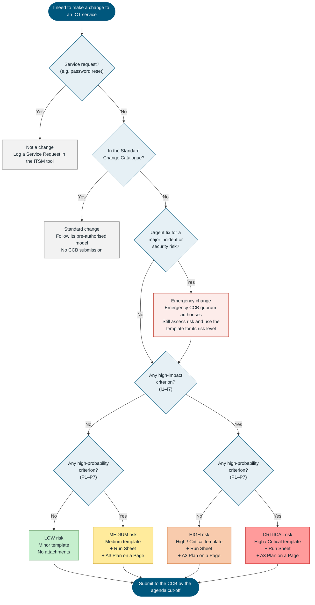
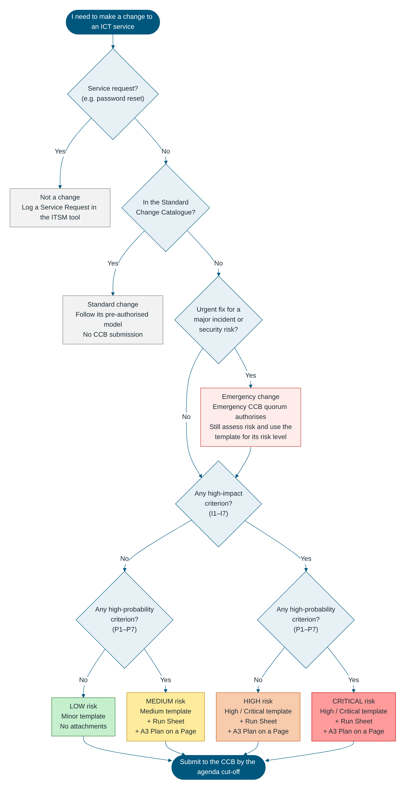

# Change Control Board (CCB) – ICT Change Submission: Medium Risk

**West Gippsland Healthcare Group (WGHG) – Information & Communication Technology**

**Single change submission for Medium risk changes – aligned to ITIL 4 Change Enablement**

> **How to use this template:** Use this form for **one** Medium risk ICT change: low impact but high probability. Every section is mandatory. Replace each `[Enter …]` placeholder and mark selections by replacing ☐ with ☒. **Attach the ICT Change Run Sheet (Excel)** and present the **A3 Plan on a Page** to the CCB: use the run sheet's Plan on a Page tab, or page 2 of the Word version of this template. If any High-Impact criterion in Section 3 applies, use the **High / Critical** template instead. Section 7 is completed by the CCB.

---

## Which Change Process Should I Follow?

*Use this flowchart and the impact and probability criteria to decide whether the work is a change, which type of change it is, its risk level, and which CCB submission template to use.*

| Impact | Probability | Risk Level | Template to Use | Attachments |
|---|---|---|---|---|
| Low | Low | Low | **Minor** | None – implementation and backout steps are written in the form |
| Low | High | Medium | **Medium** | Run Sheet (Excel) and A3 Plan on a Page |
| High | Low | High | **High / Critical** | Run Sheet (Excel) and A3 Plan on a Page; PIR always required |
| High | High | Critical | **High / Critical** | Run Sheet (Excel) and A3 Plan on a Page; PIR always required; [Enter any extra endorsement WGHG requires, e.g. Executive sponsor] |

*Risk levels follow the ITIL approach of assessing a change's impact and the probability of the risk occurring. The High / Low criteria below and the mapping to Low / Medium / High / Critical are a WGHG starting point, to be refined.*

*Confluence: Confluence does not draw Mermaid diagrams without an add-on. Upload `assets/wghg-change-process-selector.png` and insert it here, or paste the Mermaid code above into a Mermaid macro if your site has one.*

---

## Plan on a Page (A3)

*Guidance: This one-page summary of the change is presented to the CCB. In Word it prints as a single A3 landscape page. The run sheet workbook has the same layout on its **Plan on a Page** tab, where the timeline fills in automatically from the run sheet.*

### Change at a Glance

| Field | Value | Field | Value |
|---|---|---|---|
| Change ID | [CHG0001234] | CCB Meeting Date | [DD/MM/YYYY] |
| Change Title | [Enter] | Decision Requested | [Approve for implementation] |
| Change Type | [Normal / Emergency] | Overall Risk Rating | Medium |
| Approved Window | [DD/MM/YYYY HH:MM – HH:MM] | Expected Outage | [Enter duration and services] |

### What, Why and Success

| What is changing | Why it is needed | Success criteria and benefits |
|---|---|---|
| [Enter, in plain language] | [Enter driver and the consequence of not proceeding] | [Enter measurable success criteria] |

### Timeline

| Phase | Key Activities | Owner | Planned Start | Planned End |
|---|---|---|---|---|
| 1. Pre-Implementation | [Backups, notifications, pre-checks] | [Name] | [HH:MM] | [HH:MM] |
| 2. Go / No-Go | Go / No-Go decision | [Change Manager] | [HH:MM] | [HH:MM] |
| 3. Implementation | [Enter key activities] | [Name] | [HH:MM] | [HH:MM] |
| 4. Verification | [Technical and clinical verification] | [Name] | [HH:MM] | [HH:MM] |
| ◆ Backout decision point | Latest time to start a backout | [Change Manager] | [HH:MM] | — |
| 5. Post-Implementation | [Notify completion, monitor, update records] | [Name] | [HH:MM] | [HH:MM] |
| 6. Backout (only if invoked) | [Enter backout summary] | [Name] | [HH:MM] | [HH:MM] |

### Impact, Risk and Backout

| Impacted services, sites and users | Top risks and mitigations | Backout plan |
|---|---|---|
| [Services / CIs; sites and departments; number of users; clinical impact and downtime procedures] | [R1 – rating – mitigation; R2 – rating – mitigation; R3 – rating – mitigation] | [Trigger; decision point; decision maker; duration; tested ☐ Yes ☐ No] |

### Communications, Readiness and Contacts

| Communications | Readiness checklist | Key contacts |
|---|---|---|
| [Service Desk – when; clinical areas / NUMs – when; After-Hours Coordinator – when; vendors – when; all users – start and completion] | ☐ Pre-CCB endorsements ☐ Testing complete ☐ Backup / snapshot plan confirmed ☐ Run Sheet finalised ☐ Downtime procedures confirmed ☐ Vendor support confirmed ☐ Service Desk briefed | [Change Manager – name, mobile; Implementation Lead – name, mobile; Business / Clinical Owner – name, mobile; After-Hours Coordinator – phone; Vendor – phone] |

---

## 1. Change Details

| Field | Value |
|---|---|
| Change ID / RFC Number | [Enter ITSM ticket number, e.g. CHG0001234] |
| Change Title | [Enter short descriptive title] |
| CCB Meeting Date | [DD/MM/YYYY] |
| Decision Requested | ☐ Approve for implementation ☐ Note – retrospective review of an emergency change |
| Change Requester | [Name, position, department] |
| Change Owner | [Name, position] |
| Implementation Lead | [Name, team] |
| Business / Clinical Owner | [Name, position] |
| Service(s) / CI(s) Affected | [Enter] |
| Site(s) / Department(s) Affected | [Enter] |
| Number of Users Affected | [Enter] |
| Change Type | ☐ Normal ☐ Emergency |
| Proposed Implementation Window | Start: [DD/MM/YYYY HH:MM] – End: [DD/MM/YYYY HH:MM] |
| Expected Service Outage | ☐ No outage ☐ Degraded service ☐ Full outage. Duration: [Enter] |
| Related Records | [Enter related incident / problem / project IDs] |

---

## 2. Description and Justification

| Item | Details |
|---|---|
| What is changing | [Enter, in plain language] |
| Why it is needed | [Enter the driver] |
| Benefits and success criteria | [Enter measurable success criteria] |
| Consequence of not implementing | [Enter] |

---

## 3. Risk Assessment (ITIL Impact and Probability)

*Guidance: A Medium change answers **No** to every High-Impact criterion and **Yes** to at least one High-Probability criterion. If any High-Impact criterion applies, use the High / Critical template.*

### Impact and Probability Assessment

**Impact is High if ANY of these apply:**

| # | High-Impact Criterion | Applies? | Details |
|---|---|---|---|
| I1 | Affects a clinical system, patient care, or the availability of patient information | ☐ Yes ☐ No | [Enter] |
| I2 | Affects a medical device or a medical device interface | ☐ Yes ☐ No | [Enter] |
| I3 | Affects a 24/7 critical area (e.g. Emergency, ICU / HDU, Maternity, Theatres) | ☐ Yes ☐ No | [Enter] |
| I4 | Causes a user-facing outage or degraded service during clinical or business hours | ☐ Yes ☐ No | [Enter] |
| I5 | Affects more than [Enter threshold, e.g. 50] users, or more than one site | ☐ Yes ☐ No | [Enter] |
| I6 | Changes security controls, access, firewall rules, or how health or personal information is handled | ☐ Yes ☐ No | [Enter] |
| I7 | Affects integrations or interfaces with other systems | ☐ Yes ☐ No | [Enter] |

**Probability is High if ANY of these apply:**

| # | High-Probability Criterion | Applies? | Details |
|---|---|---|---|
| P1 | The change has not been done before at WGHG | ☐ Yes ☐ No | [Enter] |
| P2 | The change has not been tested in a test / UAT environment | ☐ Yes ☐ No | [Enter] |
| P3 | The change is complex: many steps, several teams or several CIs | ☐ Yes ☐ No | [Enter] |
| P4 | Success depends on a vendor or third party | ☐ Yes ☐ No | [Enter] |
| P5 | A similar change has failed or caused an incident before | ☐ Yes ☐ No | [Enter] |
| P6 | The backout has not been tested, or the change cannot be backed out | ☐ Yes ☐ No | [Enter] |
| P7 | The implementation window is tight for the work plus a full backout | ☐ Yes ☐ No | [Enter] |

| Impact ↓ / Probability → | Low Probability | High Probability |
|---|---|---|
| **High Impact** | High | Critical |
| **Low Impact** | Low | Medium |

### Key Risks and Mitigations

| # | Risk | Mitigation | Owner |
|---|---|---|---|
| R1 | [Enter risk] | [Enter] | [Name] |
| R2 | [Enter risk] | [Enter] | [Name] |
| R3 | [Enter risk] | [Enter] | [Name] |

**Overall risk level:** ☐ Medium (low impact, high probability)

---

## 4. Implementation, Testing and Backout

| Field | Details |
|---|---|
| Run Sheet attached | ☐ Yes – [Enter file name or link] |
| Implementation summary | [Enter key steps; detail in the Run Sheet] |
| Pre-implementation testing | ☐ Yes ☐ No ☐ Not applicable. [Enter evidence] |
| Post-implementation verification (technical and user) | [Enter] |
| Backout trigger(s) | [Enter] |
| Backout decision point (latest time) | [DD/MM/YYYY HH:MM] |
| Estimated backout duration | [Enter] |
| Backout tested | ☐ Yes ☐ No. [Enter details] |

---

## 5. Schedule and Communication

| Field | Details |
|---|---|
| Rationale for the window | [Enter, e.g. lowest activity, vendor availability] |
| Change Schedule and freeze periods checked | ☐ Yes – no conflicts ☐ Conflict: [Enter details] |

| Audience | When | Channel | Sender |
|---|---|---|---|
| ICT Service Desk | [Enter] | [Enter] | [Name] |
| Affected departments / users | [Enter] | [Enter] | [Name] |
| After-Hours Hospital Coordinator (after-hours changes) | [Enter] | [Enter] | [Name] |
| Vendors / third parties (if involved) | [Enter] | [Enter] | [Name] |

---

## 6. Endorsements Required Before the CCB Meeting

| Role | Name | Endorsed (Yes / No) | Date |
|---|---|---|---|
| Change Owner | [Name] | [Select] | [DD/MM/YYYY] |
| Technical Approver | [Name] | [Select] | [DD/MM/YYYY] |
| Business / Clinical Owner | [Name] | [Select] | [DD/MM/YYYY] |
| ICT Change Manager | [Name] | [Select] | [DD/MM/YYYY] |

---

## 7. CCB Decision (completed by the CCB)

| Field | Details |
|---|---|
| CCB meeting date | [DD/MM/YYYY] |
| CCB Chair | [Name, position] |
| Quorum met | ☐ Yes |
| CCB decision | ☐ Approved ☐ Approved with conditions ☐ Deferred – more information required ☐ Rejected ☐ Noted (retrospective emergency change) |
| Conditions of approval | [Enter conditions, or "Nil"] |
| Approved implementation window | [DD/MM/YYYY HH:MM – HH:MM] |
| Actions (owner / due date) | [Enter, or "Nil"] |
| CCB Chair sign-off | [Name] – [DD/MM/YYYY] |
| Minutes reference | [Enter] |

---

## 8. Implementation Record

| Field | Details |
|---|---|
| Actual start / end | [DD/MM/YYYY HH:MM] – [DD/MM/YYYY HH:MM] |
| Outcome | ☐ Successful ☐ Successful with issues ☐ Failed – backed out ☐ Failed – not backed out |
| Deviations from the approved plan or CCB conditions | [Enter, or "Nil"] |
| Incidents raised as a result | [Enter incident IDs, or "Nil"] |

---

## 9. PIR and Closure

| Field | Details |
|---|---|
| PIR required? | ☐ No ☐ Yes – the change failed, was an emergency change, or the CCB requested one |
| PIR summary and lessons learned (if required) | [Enter] |
| Follow-up actions (owner / due date) | [Enter, or "Nil"] |
| CMDB / documentation updated | ☐ Yes ☐ Not applicable |
| Final Run Sheet attached to the ITSM record | ☐ Yes |
| Closed by / date | [Name] – [DD/MM/YYYY] |

---

*West Gippsland Healthcare Group – CCB ICT Change Submission: Medium Risk – Version 1.0 – Uncontrolled when printed.*
