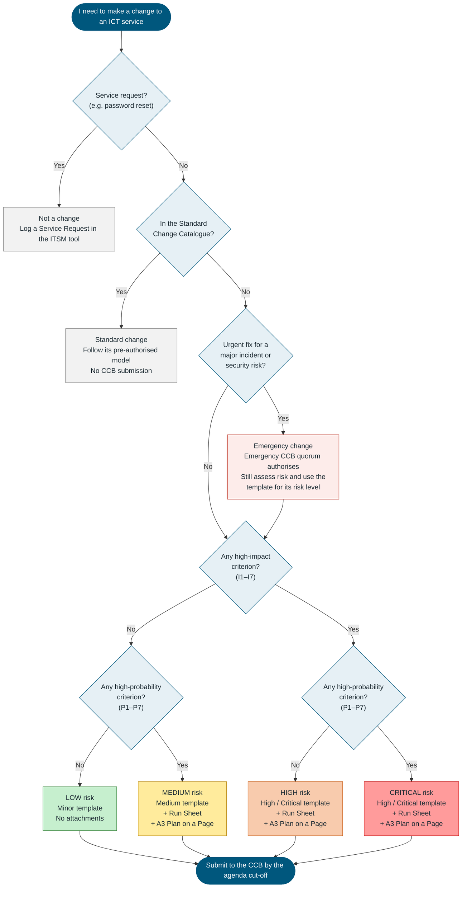
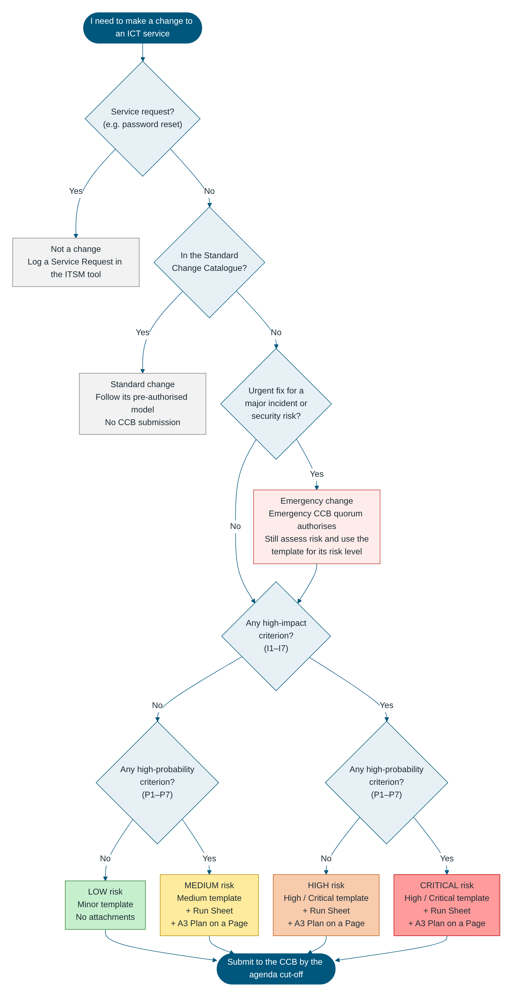

# Change Control Board (CCB) – ICT Change Submission: Minor (Low Risk)

**West Gippsland Healthcare Group (WGHG) – Information & Communication Technology**

**Short-form single change submission for Low risk changes – aligned to ITIL 4 Change Enablement**

> **How to use this template:** Use this form for **one** Low risk ICT change: low impact **and** low probability. Every field is mandatory. Replace each `[Enter …]` placeholder and mark selections by replacing ☐ with ☒. **If any criterion in Section 3 applies, stop and use the Medium or High / Critical template instead.** No attachments are required; the implementation and backout steps go in Section 4. Section 6 is completed by the CCB. The full process is in the **ICT Change Control Process** document.

---

## Which Change Process Should I Follow?

*Use this flowchart and the impact and probability criteria to decide whether the work is a change, which type of change it is, its risk level, and which CCB submission template to use.*

| Impact | Probability | Risk Level | Template to Use | Attachments |
|---|---|---|---|---|
| Low | Low | Low | **Minor** | None – implementation and backout steps are written in the form |
| Low | High | Medium | **Medium** | Run Sheet (Excel) and A3 Plan on a Page |
| High | Low | High | **High / Critical** | Run Sheet (Excel) and A3 Plan on a Page; PIR always required |
| High | High | Critical | **High / Critical** | Run Sheet (Excel) and A3 Plan on a Page; PIR always required; [Enter any extra endorsement WGHG requires, e.g. Executive sponsor] |

*Risk levels follow the ITIL approach of assessing a change's impact and the probability of the risk occurring. The High / Low criteria below and the mapping to Low / Medium / High / Critical are a WGHG starting point, to be refined.*

*Confluence: Confluence does not draw Mermaid diagrams without an add-on. Upload `assets/wghg-change-process-selector.png` and insert it here, or paste the Mermaid code above into a Mermaid macro if your site has one.*

---

## 1. Change Details

| Field | Value |
|---|---|
| Change ID / RFC Number | [Enter ITSM ticket number, e.g. CHG0001234] |
| Change Title | [Enter short descriptive title] |
| Change Requester | [Name, position, department] |
| Change Owner | [Name, position] |
| Implementer | [Name, team] |
| Service(s) / CI(s) Affected | [Enter] |
| Site(s) / Department(s) Affected | [Enter] |
| Change Type | ☐ Normal ☐ Emergency |
| CCB Meeting Date | [DD/MM/YYYY] |
| Proposed Implementation Window | Start: [DD/MM/YYYY HH:MM] – End: [DD/MM/YYYY HH:MM] |
| Expected Service Outage | ☐ No outage ☐ Degraded service ☐ Full outage. Duration: [Enter] |

---

## 2. Description and Reason

| Item | Details |
|---|---|
| What is changing | [Enter, in plain language] |
| Why it is needed | [Enter] |
| Consequence of not implementing | [Enter] |

---

## 3. Risk Assessment (ITIL Impact and Probability)

*Guidance: A Minor change must answer **No** to every criterion. If any High-Probability criterion applies, use the Medium template. If any High-Impact criterion applies, use the High / Critical template.*

### Impact and Probability Assessment

**Impact is High if ANY of these apply:**

| # | High-Impact Criterion | Applies? | Details |
|---|---|---|---|
| I1 | Affects a clinical system, patient care, or the availability of patient information | ☐ Yes ☐ No | [Enter] |
| I2 | Affects a medical device or a medical device interface | ☐ Yes ☐ No | [Enter] |
| I3 | Affects a 24/7 critical area (e.g. Emergency, ICU / HDU, Maternity, Theatres) | ☐ Yes ☐ No | [Enter] |
| I4 | Causes a user-facing outage or degraded service during clinical or business hours | ☐ Yes ☐ No | [Enter] |
| I5 | Affects more than [Enter threshold, e.g. 50] users, or more than one site | ☐ Yes ☐ No | [Enter] |
| I6 | Changes security controls, access, firewall rules, or how health or personal information is handled | ☐ Yes ☐ No | [Enter] |
| I7 | Affects integrations or interfaces with other systems | ☐ Yes ☐ No | [Enter] |

**Probability is High if ANY of these apply:**

| # | High-Probability Criterion | Applies? | Details |
|---|---|---|---|
| P1 | The change has not been done before at WGHG | ☐ Yes ☐ No | [Enter] |
| P2 | The change has not been tested in a test / UAT environment | ☐ Yes ☐ No | [Enter] |
| P3 | The change is complex: many steps, several teams or several CIs | ☐ Yes ☐ No | [Enter] |
| P4 | Success depends on a vendor or third party | ☐ Yes ☐ No | [Enter] |
| P5 | A similar change has failed or caused an incident before | ☐ Yes ☐ No | [Enter] |
| P6 | The backout has not been tested, or the change cannot be backed out | ☐ Yes ☐ No | [Enter] |
| P7 | The implementation window is tight for the work plus a full backout | ☐ Yes ☐ No | [Enter] |

| Impact ↓ / Probability → | Low Probability | High Probability |
|---|---|---|
| **High Impact** | High | Critical |
| **Low Impact** | Low | Medium |

### Main Risk

| Main Risk | Mitigation |
|---|---|
| [Enter the most likely thing that could go wrong] | [Enter how it is prevented or managed] |

**Overall risk level:** ☐ Low (all criteria answered No)

---

## 4. Implementation, Verification and Backout

### 4.1 Implementation Steps

| # | Step | Who | Est. Duration (mins) |
|---|---|---|---|
| 1 | [Enter step] | [Name] | [Enter] |
| 2 | [Enter step] | [Name] | [Enter] |
| 3 | [Enter step] | [Name] | [Enter] |
| 4 | [Enter step] | [Name] | [Enter] |

### 4.2 Verification and Backout

| Field | Details |
|---|---|
| Pre-implementation testing | ☐ Done ☐ Not required. [Enter evidence or reason] |
| How success is verified | [Enter checks after the change] |
| Backout steps | [Enter] |
| Backout trigger and latest backout time | [Enter trigger]; latest time [HH:MM] |
| Estimated backout duration | [Enter] |

---

## 5. Communication and Endorsement

| Field | Details |
|---|---|
| ICT Service Desk notified | ☐ Yes. Date: [DD/MM/YYYY] |
| Affected users / department notified | ☐ Yes ☐ Not required. Date: [DD/MM/YYYY] |
| After-Hours Hospital Coordinator notified (after-hours changes only) | ☐ Yes ☐ Not required |
| Change Owner endorsement | [Name] – [DD/MM/YYYY] |
| ICT Change Manager review | [Name] – [DD/MM/YYYY] ☐ Confirmed as Low risk (Minor) |

---

## 6. CCB Decision (completed by the CCB)

| Field | Details |
|---|---|
| CCB meeting date | [DD/MM/YYYY] |
| CCB decision | ☐ Approved ☐ Approved with conditions ☐ Deferred – more information required ☐ Rejected ☐ Noted (retrospective emergency change) |
| Conditions of approval | [Enter conditions, or "Nil"] |
| Approved implementation window | [DD/MM/YYYY HH:MM – HH:MM] |
| CCB Chair | [Name] – [DD/MM/YYYY] |
| Minutes reference | [Enter] |

---

## 7. Outcome and Closure

| Field | Details |
|---|---|
| Actual start / end | [DD/MM/YYYY HH:MM] – [DD/MM/YYYY HH:MM] |
| Outcome | ☐ Successful ☐ Successful with issues ☐ Failed – backed out ☐ Failed – not backed out |
| Incidents raised as a result | [Enter incident IDs, or "Nil"] |
| CMDB / documentation updated | ☐ Yes ☐ Not applicable |
| Lessons learned (required if the change failed or the CCB requests a PIR) | [Enter] |
| Closed by / date | [Name] – [DD/MM/YYYY] |

---

*West Gippsland Healthcare Group – CCB ICT Change Submission: Minor (Low Risk) – Version 1.0 – Uncontrolled when printed.*
