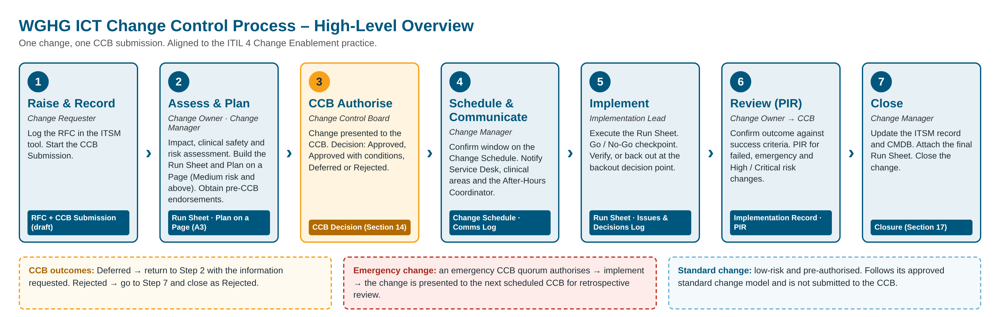
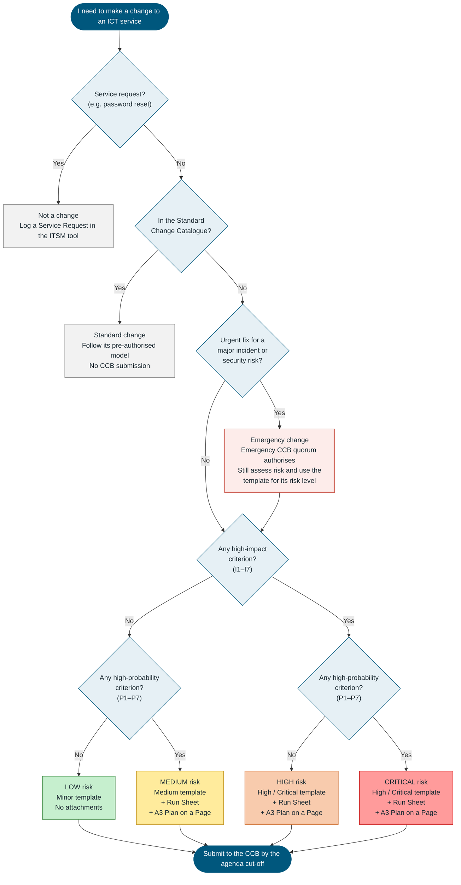
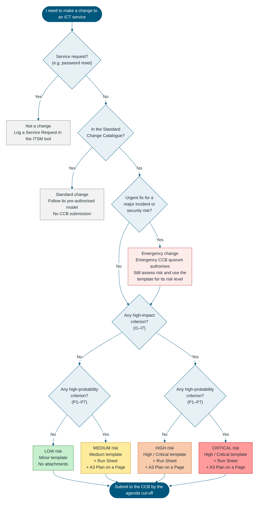

# ICT Change Control Process

**West Gippsland Healthcare Group (WGHG) – Information & Communication Technology**

**Process document – aligned to ITIL 4 Change Enablement – DRAFT for review**

> **Draft status:** This process is a draft for WGHG review. Items in `[Enter …]` placeholders must be confirmed against WGHG policy and the CCB Terms of Reference before this document is approved: CCB membership, quorum, meeting frequency, lead times, freeze periods and the risk criteria thresholds.

---

## 1. Document Control

| Field | Value |
|---|---|
| Document Title | ICT Change Control Process |
| Document Owner | [Enter, e.g. ICT Manager] |
| Approved By | [Enter, e.g. Chief Information Officer / Executive Director] |
| Version | [0.2 DRAFT] |
| Approval Date | [DD/MM/YYYY] |
| Next Review Date | [DD/MM/YYYY] |
| Related Policy | [Enter WGHG ICT Change Management Policy reference] |

### Version History

| Version | Date | Author | Summary of Changes |
|---|---|---|---|
| 0.1 | [DD/MM/YYYY] | [Name] | Initial draft |
| 0.2 | [DD/MM/YYYY] | [Name] | Added the process selector and Minor / Medium / High / Critical templates; ITIL impact × probability risk levels |

---

## 2. Process at a Glance (High-Level Overview)

*Confluence: upload `assets/wghg-change-control-process.png` to this page and insert it here. The table below is a text version of the same diagram.*

| Step | Stage | Who | What Happens | Record / Template |
|---|---|---|---|---|
| 1 | Raise & Record | Change Requester | RFC logged in the ITSM tool; risk level assessed; CCB Submission started from the template for that level | ITSM record; CCB Change Submission (Minor, Medium or High / Critical) |
| 2 | Assess & Plan | Change Owner, Change Manager | Impact and probability assessed; Run Sheet and Plan on a Page prepared (Medium and above); pre-CCB endorsements obtained | CCB Change Submission; Run Sheet; Plan on a Page (A3) |
| 3 | CCB Authorise | Change Control Board | Change presented to the CCB, which records its decision | CCB Change Submission – CCB Decision |
| 4 | Schedule & Communicate | Change Manager | Window confirmed on the Change Schedule; stakeholders notified | Change Schedule; Run Sheet – Comms Log |
| 5 | Implement | Implementation Lead | Change implemented; Go / No-Go checkpoint; verification or backout | Run Sheet (or Minor template steps); Issues & Decisions Log |
| 6 | Review (PIR) | Change Owner, reported to the CCB | Outcome confirmed; PIR completed where required | CCB Change Submission – Implementation Record and PIR |
| 7 | Close | Change Manager | ITSM record and CMDB updated; change closed | CCB Change Submission – Closure |

**CCB outcomes:** Deferred → return to Step 2 with the information requested. Rejected → go to Step 7 and close as Rejected.

**Emergency change:** an emergency CCB quorum authorises → implement → the change is presented to the next scheduled CCB for retrospective review (Section 10).

**Standard change:** low-risk and pre-authorised; follows its approved standard change model and is not submitted to the CCB (Section 7).

---

## 3. Which Change Process Should I Follow?

*Use this flowchart and the impact and probability criteria to decide whether the work is a change, which type of change it is, its risk level, and which CCB submission template to use.*

| Impact | Probability | Risk Level | Template to Use | Attachments |
|---|---|---|---|---|
| Low | Low | Low | **Minor** | None – implementation and backout steps are written in the form |
| Low | High | Medium | **Medium** | Run Sheet (Excel) and A3 Plan on a Page |
| High | Low | High | **High / Critical** | Run Sheet (Excel) and A3 Plan on a Page; PIR always required |
| High | High | Critical | **High / Critical** | Run Sheet (Excel) and A3 Plan on a Page; PIR always required; [Enter any extra endorsement WGHG requires, e.g. Executive sponsor] |

*Risk levels follow the ITIL approach of assessing a change's impact and the probability of the risk occurring. The High / Low criteria below and the mapping to Low / Medium / High / Critical are a WGHG starting point, to be refined.*

*Confluence: Confluence does not draw Mermaid diagrams without an add-on. Upload `assets/wghg-change-process-selector.png` and insert it here, or paste the Mermaid code above into a Mermaid macro if your site has one.*

---

## 4. Purpose

This document defines how WGHG ICT changes are raised, assessed, authorised by the Change Control Board (CCB), implemented, reviewed and closed. The process aims to:

- protect patient safety and the continuity of clinical and business services;
- make sure every change is assessed for impact and risk before it is made;
- give the CCB the information it needs to authorise each change, in proportion to its risk;
- reduce incidents caused by change, and restore service quickly when a change fails;
- keep an auditable record of every change.

---

## 5. Scope

| In Scope | Out of Scope |
|---|---|
| Changes to ICT infrastructure, networks, servers, storage and cloud services | Service requests (e.g. password resets, new user accounts, standard software installs) |
| Changes to clinical and business applications, interfaces and integrations | Changes to content or data that do not alter configuration (e.g. routine data entry) |
| Changes to information security controls (firewalls, access, authentication) | Non-ICT facilities changes, unless they affect ICT services |
| Changes to medical device integration managed by ICT | [Enter other exclusions confirmed by WGHG] |
| Vendor-delivered changes to WGHG ICT services | |

ITIL 4 defines a change as "the addition, modification or removal of anything that could have a direct or indirect effect on services".

---

## 6. Roles and Responsibilities

| Role | Responsibilities in this process |
|---|---|
| Change Requester | Raises the RFC; describes the change and the reason for it. |
| Change Owner | Accountable for the change end to end; assesses its risk level; prepares the CCB Submission; presents to the CCB; owns the PIR. |
| Change Manager | Owns this process; confirms the risk level and template; checks submissions are complete; maintains the Change Schedule; runs Go / No-Go; closes changes. |
| Change Control Board (CCB) | Reviews each submitted change and authorises, defers or rejects it; sets conditions; reviews PIRs and emergency changes. |
| CCB Chair | Chairs the CCB; confirms quorum; signs off CCB decisions. |
| CCB Secretariat | Manages the agenda and cut-off; distributes submission packs; records minutes and actions. |
| Implementation Lead / Implementer | Builds and tests the change; prepares and executes the Run Sheet; executes backout if required. |
| Business / Clinical Owner | Confirms business and clinical impact; endorses the change; verifies service after implementation. |
| Information Security | Reviews security and privacy impact; endorses changes with security impact. |
| ICT Service Desk | Is briefed before the change; handles user contacts; logs related incidents. |
| After-Hours Hospital Coordinator / Manager | Is notified of after-hours changes and outages; coordinates clinical areas. |

**CCB membership:** [Enter membership, e.g. ICT Manager (Chair), Change Manager, Infrastructure Lead, Applications Lead, Information Security, Clinical Informatics representative, Service Desk Lead].

---

## 7. Change Types, Risk Levels and Templates

### 7.1 Change Types (ITIL 4)

| Change Type | Definition (ITIL 4) | Authorised By | Lead Time to CCB |
|---|---|---|---|
| Standard | Low-risk, pre-authorised change that is well understood and fully documented. It can be implemented without further authorisation. | Pre-authorised standard change model (approved once by the CCB) | Not submitted to the CCB |
| Normal | Change that must be scheduled, assessed and authorised following the defined process. | CCB | Submission received by [Enter, e.g. 5 business days] before the CCB meeting |
| Emergency | Change that must be implemented as soon as possible, e.g. to resolve a major incident or apply an urgent security patch. | Emergency CCB quorum [Enter, e.g. CCB Chair plus one member] | As soon as possible; retrospective review at the next CCB |

### 7.2 Risk Levels (ITIL Impact × Probability)

Every Normal and Emergency change is given a risk level by assessing its **impact** and the **probability** of the risk occurring, following the ITIL approach. Each is rated High or Low using the criteria below. The criteria and the mapping to Low / Medium / High / Critical are a WGHG starting point, to be refined.

### Impact and Probability Criteria

**Impact is High if ANY of these apply:**

| # | High-Impact Criterion |
|---|---|
| I1 | Affects a clinical system, patient care, or the availability of patient information |
| I2 | Affects a medical device or a medical device interface |
| I3 | Affects a 24/7 critical area (e.g. Emergency, ICU / HDU, Maternity, Theatres) |
| I4 | Causes a user-facing outage or degraded service during clinical or business hours |
| I5 | Affects more than [Enter threshold, e.g. 50] users, or more than one site |
| I6 | Changes security controls, access, firewall rules, or how health or personal information is handled |
| I7 | Affects integrations or interfaces with other systems |

**Probability is High if ANY of these apply:**

| # | High-Probability Criterion |
|---|---|
| P1 | The change has not been done before at WGHG |
| P2 | The change has not been tested in a test / UAT environment |
| P3 | The change is complex: many steps, several teams or several CIs |
| P4 | Success depends on a vendor or third party |
| P5 | A similar change has failed or caused an incident before |
| P6 | The backout has not been tested, or the change cannot be backed out |
| P7 | The implementation window is tight for the work plus a full backout |

| Impact ↓ / Probability → | Low Probability | High Probability |
|---|---|---|
| **High Impact** | High | Critical |
| **Low Impact** | Low | Medium |

### 7.3 Templates by Risk Level

| Risk Level | Template | Attachments | PIR | Additional Requirements |
|---|---|---|---|---|
| Low | CCB Change Submission – **Minor** | None – steps are written in the form | Only if the change fails or the CCB requests one | — |
| Medium | CCB Change Submission – **Medium** | Run Sheet (Excel) and A3 Plan on a Page | If the change fails, was an emergency change, or the CCB requests one | — |
| High | CCB Change Submission – **High / Critical** | Run Sheet (Excel) and A3 Plan on a Page | Always | — |
| Critical | CCB Change Submission – **High / Critical** | Run Sheet (Excel) and A3 Plan on a Page | Always | [Enter, e.g. Executive sponsor endorsement] |

If the risk level changes during assessment, move the change to the template for its new level before it goes to the CCB.

---

## 8. Change Control Board (CCB)

| Item | Detail |
|---|---|
| Purpose | Assess and authorise Normal changes; review emergency changes and PIRs; maintain oversight of the Change Schedule. |
| Meeting frequency | [Enter, e.g. weekly, Tuesday 10:00] |
| Quorum | [Enter, e.g. Chair or delegate plus three members] |
| Agenda cut-off | [Enter, e.g. 5 business days before the meeting] |
| Inputs | One CCB Change Submission per change, on the template for its risk level. Medium, High and Critical changes also attach a Run Sheet and present an A3 Plan on a Page. |
| Decisions | Approved · Approved with conditions · Deferred – more information required · Rejected · Noted (retrospective emergency change) |
| Outputs | Decision recorded in the submission's CCB Decision section; minutes and actions; updated Change Schedule |
| Terms of Reference | [Enter link to the CCB Terms of Reference] |

---

## 9. Detailed Procedure – Normal Change

| # | Activity | Responsible | Output / Record | Template / Tool |
|---|---|---|---|---|
| 1.1 | Log the RFC in the ITSM tool and obtain a Change ID. | Change Requester | ITSM change record | ITSM tool |
| 1.2 | Work through the process selector (Section 3) and rate impact and probability (Section 7.2) to set the risk level. | Change Owner | Risk level | Process selector |
| 1.3 | Create the CCB Change Submission from the template for that risk level. | Change Owner | Draft submission | Minor, Medium or High / Critical template |
| 2.1 | Complete the change details, description and risk assessment. | Change Owner, with the Business / Clinical Owner and Information Security where needed | Submission sections | CCB Change Submission |
| 2.2 | Medium and above: prepare the draft Run Sheet, including backout steps and Go / No-Go checkpoints. Low: write the steps and backout in the Minor template. | Implementation Lead | Run Sheet, or Minor template steps | Run Sheet template |
| 2.3 | Medium and above: complete the A3 Plan on a Page. | Change Owner | Plan on a Page | Run Sheet – Plan on a Page tab, or the A3 page in the Word template |
| 2.4 | Check the Change Schedule and freeze periods for conflicts. | Change Manager | Schedule check recorded | Change Schedule |
| 2.5 | Obtain the endorsements required by the template. The Change Manager confirms the risk level. | Change Owner | Endorsements recorded | CCB Change Submission |
| 2.6 | Submit to the CCB Secretariat by the agenda cut-off. | Change Owner | CCB agenda item | CCB agenda |
| 3.1 | Present the change to the CCB. | Change Owner | — | Plan on a Page (Medium and above) |
| 3.2 | Make and record the decision, conditions and actions. | CCB Chair, CCB Secretariat | CCB Decision section; minutes | CCB Change Submission |
| 4.1 | Confirm the approved window on the Change Schedule. | Change Manager | Change Schedule entry | Change Schedule |
| 4.2 | Issue communications per the communication plan. | Change Manager | Comms Log | Run Sheet – Comms Log tab |
| 5.1 | Run the pre-implementation steps; hold the Go / No-Go decision. | Change Manager, Implementation Lead | Decision logged | Run Sheet; Issues & Decisions Log |
| 5.2 | Implement and verify the change; obtain business / clinical verification. | Implementation Lead, Business / Clinical Owner | Status updated | Run Sheet, or Minor template steps |
| 5.3 | If a backout trigger occurs or the backout decision point is reached, decide whether to back out and execute the backout. | Change Manager, Implementation Lead | Backout logged | Run Sheet – Phase 6 |
| 5.4 | Notify completion; record the implementation outcome. | Change Manager | Implementation Record | CCB Change Submission |
| 6.1 | Complete the PIR where required (Section 7.3) and present it to the CCB. | Change Owner | PIR | CCB Change Submission |
| 7.1 | Update the CMDB and documentation; attach the final Run Sheet; close the change. | Change Manager | Closure section; closed ITSM record | ITSM tool |

---

## 10. Emergency Change Procedure

| # | Activity | Responsible |
|---|---|---|
| E1 | Log the emergency RFC in the ITSM tool and link the related major incident or security advisory. | Change Owner |
| E2 | Rate impact and probability (Section 7.2). Complete at least the change details, description, risk assessment, backout and endorsements in the template for that risk level. | Change Owner |
| E3 | Convene the emergency CCB quorum (in person, by phone or electronically) and record its decision. | Change Manager, CCB Chair |
| E4 | Notify the Service Desk, the After-Hours Hospital Coordinator and affected clinical areas. | Change Manager |
| E5 | Implement using a Run Sheet (Medium and above) or the Minor template steps, including backout. | Implementation Lead |
| E6 | Complete the remaining sections and the PIR, and present the change to the next scheduled CCB for retrospective review ("Noted"). | Change Owner |

---

## 11. Change Freeze and Blackout Periods

| Period | Rule |
|---|---|
| [Enter, e.g. public holiday periods / end of financial year] | [Enter, e.g. Emergency changes only] |
| [Enter, e.g. major clinical system go-live periods] | [Enter rule] |
| [Enter other periods] | [Enter rule] |

Changes during a freeze period require [Enter, e.g. CCB Chair and Executive approval].

---

## 12. Implementation Controls

- **Run Sheet:** every Medium, High and Critical risk change is implemented from a Run Sheet with timed steps, owners and validation criteria. Low risk changes follow the steps written in the Minor template.
- **Go / No-Go:** implementation of a Medium, High or Critical change does not start until the Go / No-Go decision is made and recorded.
- **Backout decision point:** the run sheet sets the latest time at which a backout can start and still finish within the approved window.
- **Clinical verification:** changes affecting clinical systems are verified by the Business / Clinical Owner before completion is declared.
- **Variation:** any deviation from the approved plan or CCB conditions is logged and reported in the Implementation Record.

---

## 13. Post-Implementation Review and Closure

A PIR is required when a change:

- failed or was backed out;
- was an emergency change (Medium and above);
- was rated High or Critical risk;
- caused an incident; or
- was flagged for review by the CCB.

The Change Owner presents the PIR to the CCB, and the CCB Secretariat tracks PIR actions to completion. The Change Manager closes the change once the CMDB, documentation and ITSM record are updated.

---

## 14. Measures

| Measure | Target |
|---|---|
| Percentage of changes implemented successfully without backout | [Enter target] |
| Number of changes that caused an incident | [Enter target] |
| Percentage of emergency changes (of all changes) | [Enter target] |
| Number of unauthorised changes detected | [Enter target – normally zero] |
| Percentage of changes whose risk level was confirmed unchanged by the Change Manager | [Enter target] |
| Percentage of required PIRs completed within [Enter] days | [Enter target] |
| Percentage of CCB submissions received by the agenda cut-off | [Enter target] |

---

## 15. Records and Templates

| Record / Template | Used For | Location |
|---|---|---|
| CCB Change Submission – Minor (Word / Confluence) | Low risk changes – one per change | [Enter Confluence / document library link] |
| CCB Change Submission – Medium (Word / Confluence) | Medium risk changes – one per change | [Enter Confluence / document library link] |
| CCB Change Submission – High / Critical (Word / Confluence) | High and Critical risk changes – one per change | [Enter Confluence / document library link] |
| ICT Change Run Sheet (Excel), including the A3 Plan on a Page | Medium, High and Critical risk changes – one per change | Attached to the change's Confluence page and ITSM record |
| ITSM change record | Every change | [Enter ITSM tool] |
| Change Schedule | Every change | [Enter location] |
| CCB agenda and minutes | Every CCB meeting | [Enter location] |

---

## 16. Related Documents

| Document | Reference |
|---|---|
| WGHG ICT Change Management Policy | [Enter] |
| CCB Terms of Reference | [Enter] |
| WGHG Risk Management Framework | [Enter] |
| Clinical system downtime procedures | [Enter] |
| Information Security Policy | [Enter] |
| Major Incident Management Process | [Enter] |

---

*West Gippsland Healthcare Group – ICT Change Control Process – Version 0.2 DRAFT – Uncontrolled when printed.*
